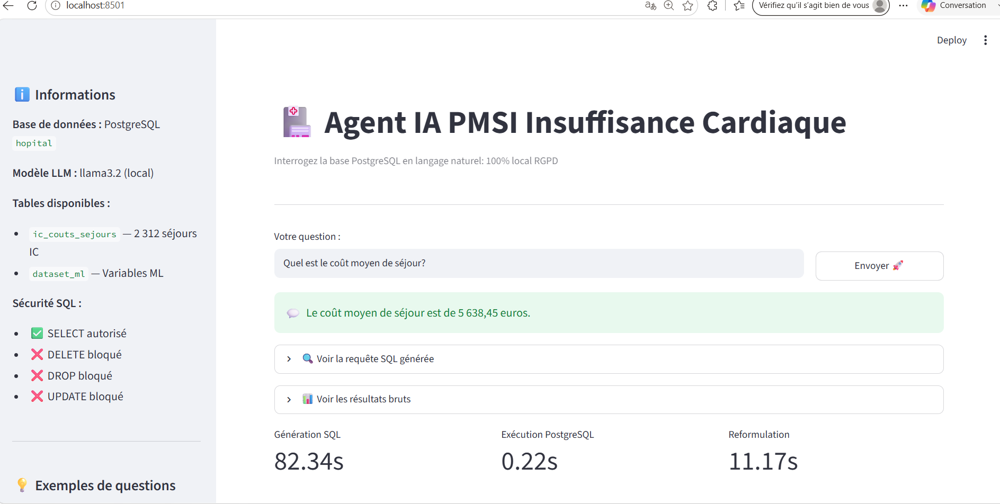
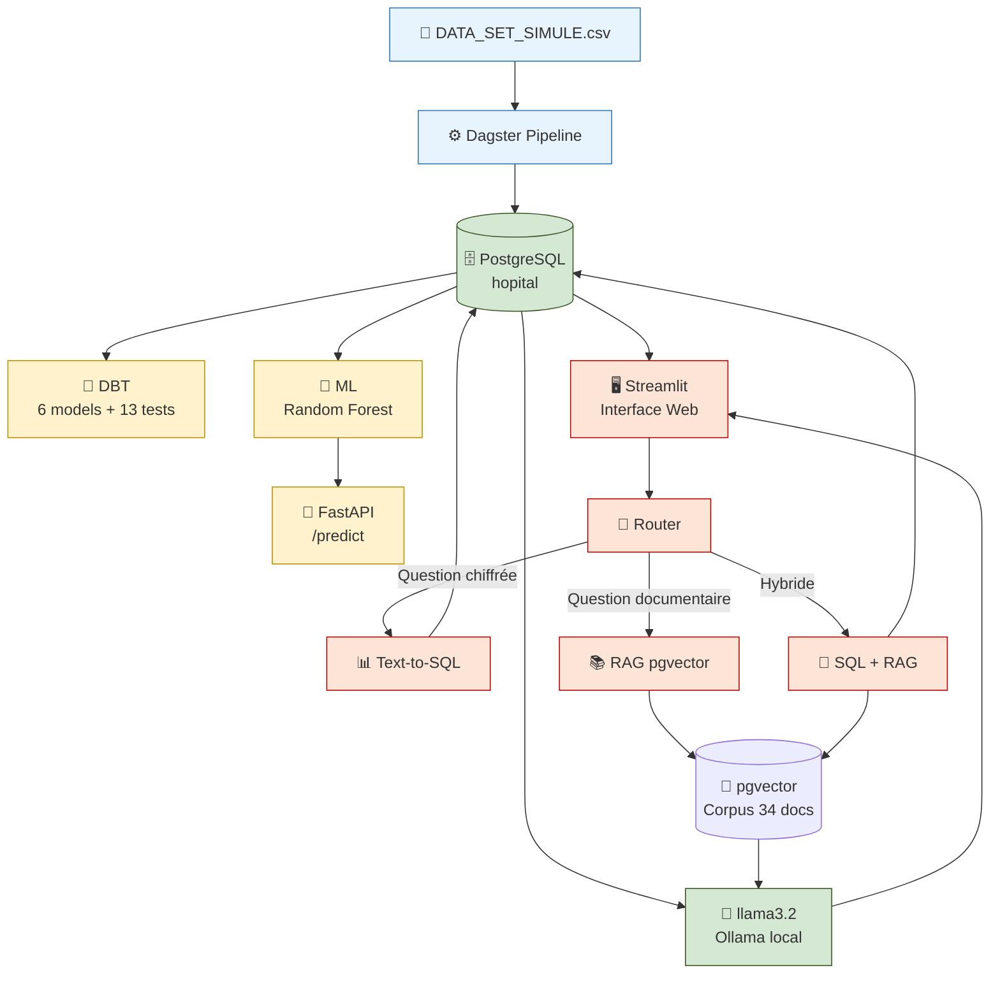
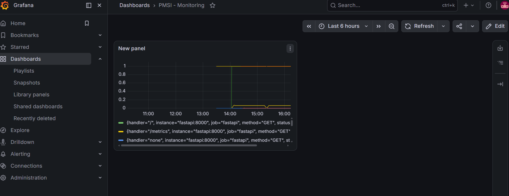

# pmsi-dagster-pipeline

[](https://github.com/octa425/pmsi-dagster-pipeline/actions/workflows/deploy.yml)
## Interface de démonstration



> Interface Streamlit : Agent IA PMSI interrogeant PostgreSQL

> en langage naturel :  100% local   RGPD compliant

### Lancer l'interface

```bash

streamlit run app_streamlit.py

# → Ouvrir http://localhost:8501

```
## Architecture du projet




Pipeline ETL/ELT de données hospitalières PMSI-MCO: Dagster, Polars, PostgreSQL, DBT | Analyse épidémio-économique : BPCO, Insuffisance Cardiaque, Tarifs ATIH 2026

## ⚠️ Nature des données

L'ensemble des résultats présentés dans ce projet (volumétrie des séjours, coûts ATIH, taux de réadmission) a été produit à partir d'un jeu de données **entièrement simulé** (`DATA_SET_SIMULE.csv`, environ 3 000 séjours), généré pour reproduire la structure et la volumétrie d'un export PMSI réel (NIP, NDA, GHM, GHS, codes CIM-10, dates de séjour). **Aucune donnée patient réelle n'a été utilisée à aucune étape de ce projet.** Ce choix garantit la conformité RGPD tout en permettant de démontrer un pipeline ETL/ELT complet sur un cas d'usage réaliste. Le fichier est disponible dans ce repo pour reproduire le pipeline de bout en bout.

## Avertissement méthodologique

La jointure entre les séjours et les tarifs ATIH est réalisée sur la clé GHS/GHM à titre purement démonstratif.

Dans un contexte de production réel, cette jointure devrait se baser sur une correspondance au NDA (numéro de séjour) couplée aux GHM via le fichier ATIH, afin d'éviter d'associer des tarifs de pathologies différentes partageant le même GHM. Un patient avec hépatite B et un patient avec insuffisance cardiaque peuvent partager le même GHM : notre jointure ramènerait alors un tarif incorrect.

Les résultats financiers présentés ne constituent pas une analyse médico-économique certifiée. Ils sont produits dans un contexte de démonstration technique, en l'absence des tables de correspondance CIM-10 vers GHM officielles.
## 🚀 Démarrage rapide: Reproduire le pipeline

### Prérequis

- Windows 10/11 avec WSL2 activé
- Ubuntu 24.04 (via Microsoft Store)
- Python 3.11+
- Git
- Docker (optionnel)
- Ollama (optionnel pour l'agent IA)

---

### Étape 1 : Cloner le dépôt

```bash
git clone https://github.com/octa425/pmsi-dagster-pipeline.git
cd pmsi-dagster-pipeline
```

---

### Étape 2 : Installer PostgreSQL

```bash
sudo apt update
sudo apt install postgresql -y
sudo service postgresql start
```

Définir un mot de passe PostgreSQL :

```bash
sudo -u postgres psql
```

Puis dans psql :

```sql
ALTER USER postgres PASSWORD '<CHANGE_ME>';
\q
```

---

### Étape 3 : Créer la base de données

```bash
sudo -u postgres createdb hopital
```

Vérifier la création :

```bash
psql -h localhost -U postgres -l
```

---

### Étape 4 : Créer l'environnement virtuel

```bash
python3 -m venv dagster_env
source dagster_env/bin/activate
```

---

### Étape 5 : Installer les dépendances

```bash
pip install -r requirements_docker.txt
```

---

### Étape 6 : Lancer Dagster

```bash
dagster dev -f definitions_ic.py -h 0.0.0.0 -p 3000
```

Ouvrir ensuite **http://localhost:3000** puis cliquer sur **Materialize All**
afin d'exécuter l'ensemble du pipeline.

---

### Étape 7 : Vérifier les données chargées

```bash
psql -h localhost -U postgres -d hopital
```

```sql
SELECT COUNT(*) FROM pmsi_mco_analytics.ic_couts_sejours;
```

Le résultat attendu est **2 312 séjours** chargés dans PostgreSQL.

---

### Étape 8  Lancer l'agent IA (optionnel)

Installer Ollama :

```bash
curl -fsSL https://ollama.com/install.sh | sh
```

Télécharger le modèle :

```bash
ollama pull llama3.2
```

Installer les dépendances Python :

```bash
pip install ollama psycopg2-binary
```

Lancer l'agent :

```bash
python3 agent_llm_pmsi.py
```

Exemples de questions :
Combien y a-t-il de séjours au total ?

Quel est le coût moyen d'un séjour ?

Quel est le coût total des séjours ?
L'agent :

1. Comprend la question en français
2. Génère automatiquement une requête SQL
3. Interroge PostgreSQL
4. Restitue la réponse en langage naturel

#### 🔒 Sécurité de l'agent IA

L'agent implémente un filtrage empêchant l'exécution de commandes destructrices :
`DROP` `DELETE` `UPDATE` `ALTER` `TRUNCATE` `CREATE` `GRANT` `REVOKE`

Exemple :
Question : DROP TABLE ic_couts_sejours

⛔ SECURITE : Requete refusee : contient 'DROP'
---

### Étape 9 — Docker (optionnel)

Construire l'image :

```bash
docker build -t pmsi-dagster .
```

Exécuter le conteneur :

```bash
docker run -p 3000:3000 pmsi-dagster
```

> **Remarque** : cette étape suppose qu'une instance PostgreSQL
> est disponible ou configurée via les variables d'environnement.

---

## 📊 Monitoring — Prometheus + Grafana

Le projet inclut un stack de monitoring complet via docker-compose : Prometheus collecte les métriques applicatives (FastAPI, PostgreSQL) et Grafana les visualise dans un dashboard dédié.

### Services
- **Prometheus** (`http://localhost:9090`) — collecte des métriques toutes les 15s
- **Grafana** (`http://localhost:3001`) — visualisation, login `admin` / mot de passe défini dans `.env`
- **postgres_exporter** — expose les métriques PostgreSQL au format Prometheus

### Targets surveillées
| Target | Endpoint | Métrique |
|---|---|---|
| FastAPI | `fastapi:8000/metrics` | Requêtes HTTP, latence, taux d'erreur |
| PostgreSQL | `postgres_exporter:9187` | Connexions, requêtes, santé de la base |
| Prometheus | `localhost:9090` | Auto-monitoring |

### Dashboard Grafana

> Visualisation du taux de requêtes HTTP par endpoint (`/`, `/metrics`, `/predict`)

### Lancer le monitoring
```bash
docker-compose up -d prometheus grafana postgres_exporter
```
Puis ouvrir `http://localhost:3001` (Grafana) et `http://localhost:9090/targets` (Prometheus) pour vérifier l'état des services.

---
## 🛠️ Technologies utilisées

| Technologie | Usage |
|---|---|
| Python | Langage principal |
| PostgreSQL | Base de données relationnelle |
| Dagster | Orchestration du pipeline |
| Polars | Transformation des données |
| DBT | Modélisation SQL |
| Docker | Conteneurisation |
| GitHub Actions | CI/CD automatisé |
| Ollama + Llama 3.2 | Agent LLM local |
| Prometheus | Collecte de métriques |
| Grafana | Visualisation / dashboards |
| Linux / WSL | Environnement d'exécution |

---
## Pipeline DBT PMSI

Modélisation SQL en 3 couches sur données PMSI simulées.
Reproduction du pipeline SAS de l'ORS Guyane en SQL.

### Structure

- `staging/` → Nettoyage des tables brutes
  - `stg_mco_b.sql` → T_MCO_B nettoyée
  - `stg_mco_c.sql` → Chaînage NIR + 7 contrôles qualité
  - `stg_mco_d.sql` → Comorbidités avec libellés

- `intermediate/` → Logique métier PMSI
  - `int_filtres_pmsi.sql` → Reproduction FILTRESS973 SAS
  - `int_cohorte_avc.sql` → Sélection I60-I64 + G46

- `marts/` → Tables analytiques finales
  - `mart_survie_avc.sql` → Mortalité J30 et J365

### Lancer DBT

```bash
cd pmsi_dbt
dbt run    # Exécuter tous les models
dbt test   # Lancer les 13 tests qualité
dbt docs serve  # Documentation interactive
```

### Résultats (données simulées)

| Indicateur | Résultat |
|---|---|
| Patients AVC identifiés | 400 |
| Mortalité à J30 | 13.5% |
| Mortalité à J365 | 23.2% |
| Survie à J30 | 86.5% |
| Survie à J365 | 76.8% |
| Tests qualité | 13 ✅ |

## Résultats BPCO et Insuffisance Cardiaque
### BPCO :  Exacerbations
| Indicateur | Résultat |
|---|---|
| Séjours BPCO analysés | 668 |
| Taux réadmission J30 | 18.2% |
| Coût moyen séjour | 4 127 € |
| DMS moyenne | 7.3 jours |
### Insuffisance Cardiaque
| Indicateur | Résultat |
|---|---|
| Séjours IC analysés | 2 312 |
| Coût total | 13 061 256 € |
| Coût moyen séjour | 5 649 € |
| Taux réadmission J30 | 22.4% |
| GHM le plus fréquent | 05M09 — Insuffisance cardiaque |

## Benchmark Text-to-SQL

L'agent a été évalué sur 21 questions PMSI
de référence avec un script automatique (`eval.py`).

| Type de question | Précision |
|---|---|
| COUNT | 100% |
| MOYENNE | 100% |
| SOMME | 100% |
| MAX / MIN | 100% |
| GROUPE | 100% |
| DATE | 100% |
| SÉCURITÉ SQL | 100% |
| COMPLEXE | 100% |
| FILTRE | 80% |
| **GLOBAL** | **95.2%** |

> Le seul échec concerne une ambiguïté sémantique :
> "J30" peut signifier "30 jours" ou le code CIM-10 J30
> (rhinite allergique). C'est une limite documentée des LLM.

### Lancer le benchmark

```bash
python3 eval.py
```
